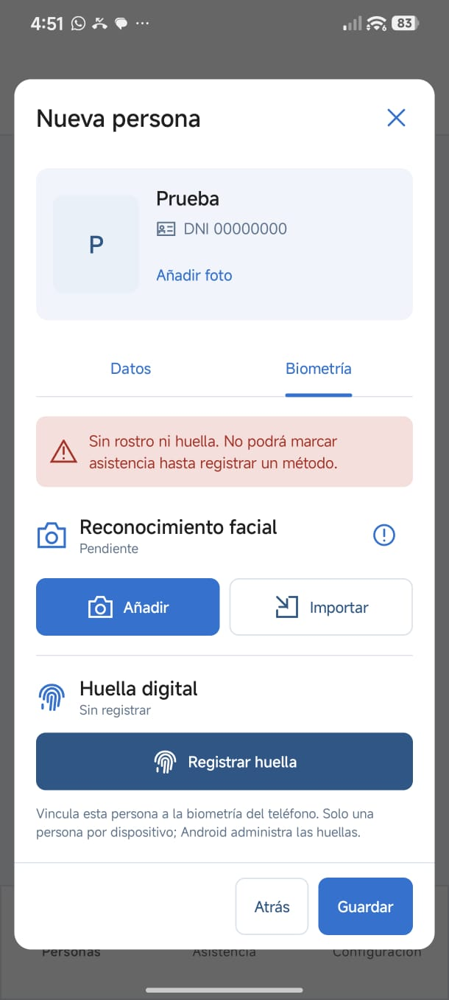
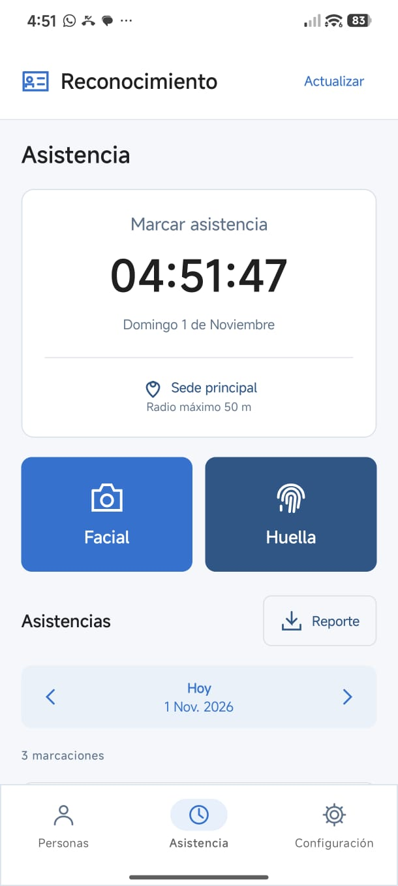
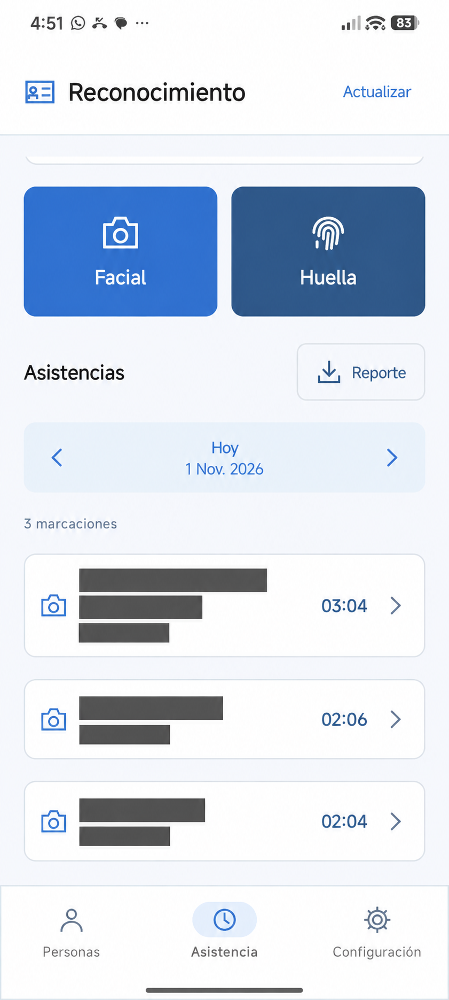
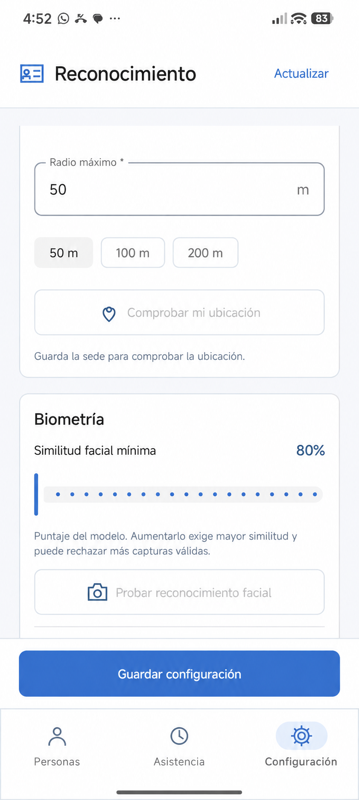

# Reconocimiento y asistencia

Aplicación Android para registrar personas y controlar su asistencia mediante reconocimiento facial o biometría del teléfono. La marcación exige estar dentro de la sede configurada y se permite una asistencia por persona al día, con hora de Lima.

**Alcance de Huella:** Android autoriza la cuenta vinculada al dispositivo. La aplicación no extrae ni guarda las huellas del sensor interno y no identifica a varios trabajadores por su dedo en un teléfono compartido. Esa modalidad requiere un lector externo compatible.

## Capturas

<table>
  <tr>
    <td align="center"><strong>Registro de persona</strong><br></td>
    <td align="center"><strong>Marcación de asistencia</strong><br></td>
  </tr>
  <tr>
    <td align="center"><strong>Historial y reporte</strong><br></td>
    <td align="center"><strong>Configuración</strong><br></td>
  </tr>
</table>

Las capturas se anonimizaron para ocultar nombres, DNI y coordenadas precisas. La ficha «Prueba» utiliza datos ficticios.

## Funciones

- **Personas:** registro, búsqueda por DNI o nombre, edición, baja y advertencias de biometría pendiente.
- **Rostro:** registro guiado, actualización e importación de fotos con recorte y validaciones.
- **Asistencia:** reconocimiento, control de zona/red y bloqueo de marcaciones duplicadas.
- **Historial:** consulta por calendario y detalle con fecha, hora, método, fotos y ubicación.
- **Reporte:** consulta por período y descarga de Excel `.xlsx`.
- **Configuración:** mapa con pin ajustable, círculo del radio, red permitida y mínimo facial.

## Tecnologías

| Tecnología | Función |
| --- | --- |
| Kotlin, Compose y Material 3 | Interfaz Android. |
| CameraX y ML Kit | Cámara, detección de rostro, postura y ojos. |
| FaceNet 512 y LiteRT | Descripción numérica del rostro para su comparación. |
| FaceAttribNet | Comprobación de lentes y mascarilla. |
| BiometricPrompt y Android Keystore | Autorización biométrica y firma de retos del dispositivo. |
| Play services Location | Ubicación y precisión GPS. |
| Leaflet y OpenStreetMap | Mapa, pin y radio de la sede. |
| Java 25, Spring Boot y JDBC | API, validaciones y acceso a datos. |
| PostgreSQL | Personas, plantillas faciales, vínculos, asistencias y ensayos. |
| Apache POI | Generación del Excel. |

Las versiones están fijadas en [libs.versions.toml](gradle/libs.versions.toml) y [pom.xml](backend/pom.xml). La procedencia y las condiciones de los modelos se detallan en [THIRD_PARTY.md](THIRD_PARTY.md). No se utiliza Python ni una API externa de reconocimiento.

## Instalación en Windows

### 1. Requisitos

Se requieren Android Studio, Android SDK 37 y Platform Tools, JDK 25, PostgreSQL 18 y Maven 3.9.16. Gradle se descarga mediante el wrapper incluido. La app admite Android 7.0 o superior; los binarios incluidos soportan ARM64 y emuladores x86_64.

```powershell
git clone https://github.com/alexisgg11/movil_reconocimiento.git
cd movil_reconocimiento
```

### 2. Rutas y modelos

Se configuran las rutas reales del equipo. El siguiente bloque muestra un ejemplo; Android Studio también debe tener acceso a estas variables y al JDK seleccionado.

```powershell
$env:RECONOCIMIENTO_JAVA_HOME = 'C:\Herramientas\jdk-25'
$env:JAVA_HOME = $env:RECONOCIMIENTO_JAVA_HOME
$env:RECONOCIMIENTO_MAVEN_HOME = 'C:\Herramientas\apache-maven-3.9.16'
$env:RECONOCIMIENTO_PG_BIN = 'C:\Program Files\PostgreSQL\18\bin'
$env:ANDROID_HOME = 'C:\Android\Sdk'
.\scripts\setup-models.ps1
```

El script descarga los modelos desde sus versiones fijadas y comprueba su SHA-256. Los pesos no se almacenan en este repositorio. La primera preparación y sincronización requieren internet.

### 3. Base de datos

Se crea el archivo local de configuración si todavía no existe:

```powershell
if (-not (Test-Path -LiteralPath '.\backend\.env')) {
    Copy-Item -LiteralPath '.\backend\.env.example' -Destination '.\backend\.env'
}
```

En `backend/.env` se completan los datos de PostgreSQL:

```dotenv
DB_URL=jdbc:postgresql://localhost:5432/reconocimiento_app
DB_USER=postgres
DB_PASSWORD=CONFIGURAR_PASSWORD
PORT=8082
PHOTO_DIRECTORY=storage/fotos
POSTGRES_SERVICE=postgresql-x64-18
```

`CONFIGURAR_PASSWORD` se sustituye por la contraseña local. El servicio se ajusta si tiene otro nombre. `PORT` permanece en `8082`; las fotos actuales se guardan en PostgreSQL, aunque se conserva la variable `PHOTO_DIRECTORY` del entorno.

### 4. Servidor y app

```powershell
.\scripts\start-local-services.ps1
Invoke-RestMethod 'http://127.0.0.1:8082/api/health'
```

El arranque comprueba PostgreSQL, crea la base si falta y prepara el esquema. El usuario de desarrollo necesita permiso para crear la base o esta debe existir previamente. Los logs quedan en `.local/api.log`.

Después se abre el proyecto en Android Studio, se sincroniza Gradle, se selecciona un teléfono o emulador y se ejecuta **app**. Se autorizan cámara, ubicación precisa y red local cuando Android lo solicita. El arranque del servidor también se ejecuta antes de compilar debug.

## Conexión del teléfono

| Entorno | Dirección de la app | Conexión |
| --- | --- | --- |
| Emulador | `http://10.0.2.2:8082/api` | Acceso a la PC anfitriona. |
| Teléfono USB | `http://127.0.0.1:8082/api` | Túnel ADB en el puerto 8082. |
| Teléfono por Wi-Fi | `http://127.0.0.1:8082/api` | ADB inalámbrico con el mismo túnel. |

Para USB se habilita Depuración USB y se acepta la autorización de la PC. En POCO/Xiaomi puede ser necesario permitir también la instalación por USB.

```powershell
$adb = Join-Path $env:ANDROID_HOME 'platform-tools\adb.exe'
& $adb devices
& $adb -s 'SERIAL_DEL_TELEFONO' reverse tcp:8082 tcp:8082
```

El serial se obtiene de `adb devices`. El script de arranque prepara el túnel de los teléfonos conectados. Para Wi-Fi se realiza la vinculación desde **Android Studio → Pair Devices Using Wi-Fi** y **Opciones de desarrollador → Depuración inalámbrica** en el teléfono. PC y teléfono deben conservar la conexión; la PC y la API permanecen encendidas.

Con el túnel, la API normalmente observa `127.0.0.1`, incluso por Wi-Fi. **Usar conexión actual** permite configurar el filtro con esa IP efectiva. La app actual no incluye cambio de URL del servidor desde la interfaz.

## Uso

1. En **Configuración**, se selecciona la sede, se ajustan el pin y el radio y se guardan los cambios.
2. En **Personas → Nuevo**, se completan DNI y nombre. **Siguiente** valida el DNI y abre Biometría.
3. El rostro se añade con cámara o **Importar**. El botón **!** muestra las indicaciones. El registro y la actualización usan tres pasos automáticos; la asistencia solicita una sola posición frontal.
4. **Registrar huella** prepara el vínculo con la biometría ya configurada en Android. Solo se admite una persona vinculada por teléfono. Los cambios se confirman con **Guardar**.
5. En **Asistencia**, se elige Facial o Huella. La API valida identidad, zona, red opcional y duplicados antes de guardar.
6. Las flechas o el calendario permiten consultar otros días. Al pulsar una asistencia se abre su detalle; **Reporte → Excel** permite guardar el archivo.

Una baja retira el rostro y el vínculo del dispositivo, pero conserva el historial. La app consulta la API cada cinco segundos mientras está visible; las versiones de datos controlan conflictos durante la edición.

## Validaciones importantes

- El servidor exige `distancia a la sede + precisión GPS <= radio`. La incertidumbre del GPS no amplía el límite.
- La similitud facial mínima comienza en `0.80` y se rechazan coincidencias ambiguas. Ese puntaje no representa una probabilidad de identidad ni una precisión garantizada.
- La cámara controla postura, ojos, estabilidad, luz, nitidez y accesorios. Una foto importada sirve para registrar un rostro, no para acreditar presencia.
- Los ensayos de **Configuración → Probar reconocimiento facial** no generan asistencia ni entrenan automáticamente el modelo.
- La huella del teléfono autoriza una firma; la base conserva su clave pública vinculada al DNI, no una plantilla dactilar.

## Estructura del proyecto

```text
app/src/main/java/com/example/reconocimiento/
  domain/        Modelos, contratos y casos de uso
  data/          HTTP, IA, fotos, GPS y biometría
  ui/            Pantallas, diálogos y ViewModel
  MainActivity.kt  Permisos y composición de dependencias
backend/src/main/java/com/example/reconocimiento/
  api/           Endpoints y exportación Excel
  application/   Operaciones y transacciones
  domain/        Reglas y contratos de persistencia
  data/          Consultas JDBC
scripts/         Arranque, modelos y verificaciones
docs/capturas/   Imágenes anonimizadas de la aplicación
```

La conexión sigue el flujo **Android → API Java → PostgreSQL**. Android realiza la inferencia facial y envía las plantillas y fotos necesarias a la API del proyecto. La API compara, valida y guarda; la app no se conecta directamente a PostgreSQL.

`reconocimiento_app` contiene los datos de uso. `reconocimiento_verificacion` es una base aislada y desechable para pruebas. Las tablas se crean desde [schema.sql](backend/src/main/resources/db/schema.sql).

## Comprobaciones

```powershell
.\scripts\maven.ps1 -MavenArguments @('test','package')
.\scripts\test-postgres.ps1
.\scripts\audit-storage.ps1
.\gradlew.bat :app:testDebugUnitTest :app:lintDebug -PSTART_LOCAL_SERVICES=false
```

La última validación funcional pasó 42 pruebas de servidor, 33 unitarias Android y 36 instrumentadas. Las pruebas instrumentadas y sus imágenes se preparan únicamente en el emulador mediante `test-face-model.ps1` y `test-face-attributes.ps1`; el APK de pruebas no se instala en el teléfono de uso. Para las pruebas de cámara se utilizan cámaras emuladas independientes.

La auditoría de almacenamiento es de solo lectura. `backend/.env`, datos reales, informes locales y compilados están excluidos de Git. La entrega utiliza HTTP local en debug; no incluye autenticación administrativa por roles, despliegue público ni prueba de vida certificada.